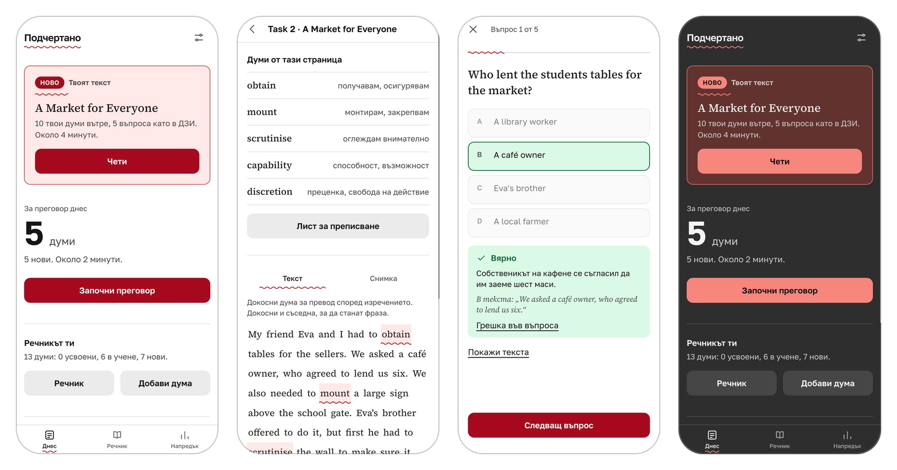

<p align="center">
  
</p>

<h1 align="center">Подчертано</h1>

<p align="center">
  <b>Underline words in your textbook. Actually learn them.</b><br>
  A mobile-first web app that turns pencil-underlined words into a personal dictionary,<br>
  spaced repetition, and daily exam-style reading practice.
</p>

<p align="center">
  
  
  
  
  
</p>

<p align="center">
  
</p>

*„Подчертано“ means “underlined” in Bulgarian. The interface is in Bulgarian; the content being learned is English.*

## What it is

A 12th-grader preparing for the Bulgarian state matriculation exam (ДЗИ) in English learns the old-fashioned way: underline unknown words in the workbook with a pencil. **Подчертано keeps that habit and does the boring parts** — finding the underlined words, translating them in context, remembering them, and bringing them back at the right time.

## Features

- **Scan a page.** Photograph a workbook page; the app reads the text, finds the pencil-underlined words, and lets you correct the selection with a tap.
- **Translation in context.** For every word: a Bulgarian translation, a short explanation, part of speech and an example sentence. Type a word, or paste a whole list, and everything is filled in for you.
- **Spaced repetition.** Reviews are scheduled with [FSRS](https://github.com/open-spaced-repetition/ts-fsrs) and mix multiple choice, fill-in-the-blank, typing and listening. Answer checking is forgiving where it should be (UK/US spelling, synonyms, small typos).
- **“Твоят текст” (Your Text).** Every day the app writes a short text built from the learner's own weakest words, with five exam-style questions and Bulgarian explanations. Reading it counts as a review: no typing needed.
- **Saved pages.** Every scanned page is archived with its photo; tap any word to see its translation.
- **Built for phones.** Installable PWA, offline-tolerant review queue, light and dark themes, and a hand-drawn “wave underline” as the visual motif.

## How it works

```
photo ─► text + underlined words ─► pick words ─► translation ─► personal dictionary
                                                                      │
                                       FSRS review  ◄─────────────────┤
                                       daily reading + questions  ◄───┘
```

## Tech stack

| | |
|---|---|
| **App** | Next.js 16 (App Router, server actions), React 19, TypeScript, Tailwind CSS 4 |
| **Data** | PostgreSQL on Neon, Drizzle ORM |
| **Auth** | Better Auth (username and password; accounts are created by the owner) |
| **Learning** | ts-fsrs, custom answer checking, frequency-aware word selection |
| **AI** | OpenAI API for page reading, translation and reading practice, behind cost guards |
| **OCR** | tesseract.js in the browser (word positions and offline fallback) |
| **Quality** | Vitest, integration scripts against a real database with a fake AI server |
| **Hosting** | Vercel |

## Engineering notes

- **AI is opt-in and metered.** It is off unless explicitly enabled; every call is recorded, with a per-user daily limit and a hard monthly spending cap.
- **Generated content is validated, not trusted.** A reading text only reaches the learner if every target word really appears in it and every question is backed by an exact quote from the text. Otherwise: one retry, then a clear error.
- **Reviews are idempotent.** Client-generated ids mean a flaky connection or a double tap never counts a review twice.
- **Designed against “AI-looking” UI.** Neutral palette, one accent colour (red pencil), serif for reading, and a single recurring motif instead of decoration. See [`docs/planning/PRODUCT.md`](docs/planning/PRODUCT.md).

## Getting started

```bash
cd app
pnpm install
cp .env.example .env.local     # add DATABASE_URL and BETTER_AUTH_SECRET
pnpm db:migrate
pnpm user:create <username>    # prints a temporary password
pnpm dev
```

AI features are optional: set `AI_ENABLED=1` and `OPENAI_API_KEY` in `.env.local` to turn them on (see `.env.example` for the limits). Run the tests with `pnpm test`.

## Repository layout

```
app/                  Next.js application
  src/modules/        scan · vocab · review · reading
  src/core/           ai · auth · db · srs · offline
  scripts/            user management, integration tests, OCR lab scripts
bench/                early OCR and vision experiments
docs/                 screenshots and planning notes (Bulgarian)
```

## Docs

Planning and decision notes, written in Bulgarian: [product brief](docs/planning/PRODUCT.md) · [master plan](docs/planning/PLAN.md) · [OCR and AI benchmarks](docs/planning/STAGE0.md) · [review redesign](docs/planning/PLAN-REVIEW.md) · [reading practice](docs/planning/PLAN-READING.md)

---

<p align="center"><sub>Built by <a href="https://github.com/tgarmenliev">Tihomir Garmenliev</a> for a friend and his exam.</sub></p>
